# Building Vaper Taper

*Taper the vaper.*

This is the story of how I built a tiny gadget that counts every puff I take from my vape and sends it to an app on my phone and PC. I had never done any hardware before this. I'd never soldered, never used a multimeter properly and never programmed a microcontroller. So this blog is written for someone like me a week ago. Every step is in here, including the bits that went wrong.

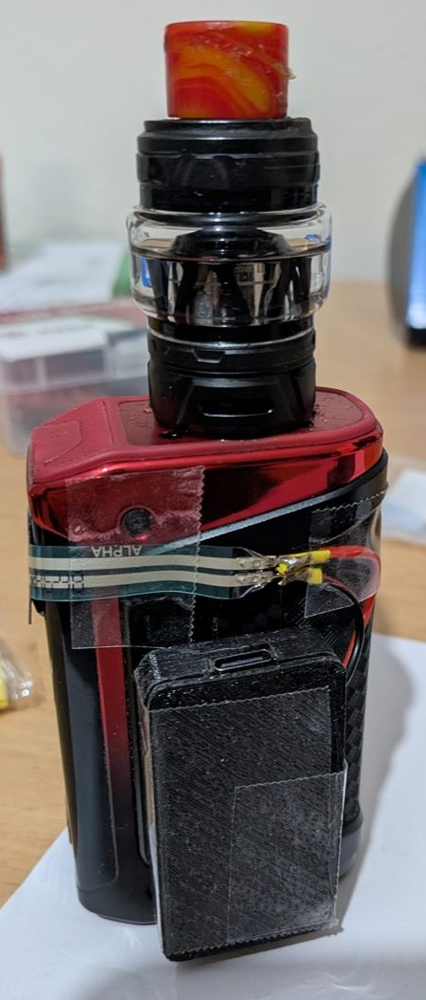

## Contents

- [Building Vaper Taper](#building-vaper-taper)
  - [Contents](#contents)
  - [1. Why I wanted this](#1-why-i-wanted-this)
  - [2. The plan](#2-the-plan)
  - [3. Ordering the parts](#3-ordering-the-parts)
  - [4. Unboxing and first tests](#4-unboxing-and-first-tests)
  - [5. Making the board blink](#5-making-the-board-blink)
  - [6. Testing Bluetooth](#6-testing-bluetooth)
  - [7. Designing and printing the case](#7-designing-and-printing-the-case)
    - [Printing it](#printing-it)
  - [8. Preparing the battery cable](#8-preparing-the-battery-cable)
    - [Stripping the wires](#stripping-the-wires)
    - [Checking which wire is positive](#checking-which-wire-is-positive)
  - [9. My soldering iron broke :(](#9-my-soldering-iron-broke-)
  - [10. Learning to solder](#10-learning-to-solder)
    - [Looking after the tip](#looking-after-the-tip)
    - [Making a joint](#making-a-joint)
    - [Using heat-shrink](#using-heat-shrink)
  - [11. Soldering the resistor](#11-soldering-the-resistor)
    - [What went wrong](#what-went-wrong)
  - [12. Soldering the two sensor wires](#12-soldering-the-two-sensor-wires)
  - [13. Soldering the sensor](#13-soldering-the-sensor)
  - [14. Soldering the battery lead](#14-soldering-the-battery-lead)
  - [15. Testing the whole circuit](#15-testing-the-whole-circuit)
    - [What went wrong](#what-went-wrong-1)
    - [On battery](#on-battery)
  - [16. Giving it a name](#16-giving-it-a-name)
  - [17. The firmware](#17-the-firmware)
  - [18. The app](#18-the-app)
    - [What went wrong](#what-went-wrong-2)
  - [19. Putting it on the vape](#19-putting-it-on-the-vape)
  - [20. What I learned](#20-what-i-learned)
  - [21. What's next](#21-whats-next)

---

## 1. Why I wanted this

I need to vape less. Since working from home over the past couple of years, I vape practically 24/7. The problem is that it's such an unconscious habit that there is little awareness of my patterns of use. I pick the vape up and take a puff without thinking. It's hard to cut down on something you don't pay too much attention to.

My vape, a **Geekvape Aegis Legend 5**, has a puff counter on its screen, but it's not much use:

- I have to remember to look at it.
- It has no history. It can't tell me *when* I vape, or how long each puff is.
- The data never leaves the vape.

So I decided to build my own logger. It would notice every puff by itself, remember the time, and send it to my phone. That way I could see my habits and try to beat them.

Primarily though, it was a fun project for learning a bit of hardware engineering, which I'd never done before. 

## 2. The plan

I asked Claude how I could log my puffs over Bluetooth given my vape model. It suggested the following:

| Idea | Do I have to open the vape? | Caveats |
|---|---|---|
| A sensor on top of the fire button | No | Hardware would sit on the outside and would count button presses rather than actual puffs. |
| A pressure sensor in the mouthpiece | No | It would need to be food-safe. |
| A wire soldered to the fire button inside | Yes | Opening the vape might ruin the water resistance and void the warranty. |
| Measure the current to the coil | Yes | Over 30 amps flows to the coil so it would need heavy-duty parts and may introduce risk of fire. |

While a stealthy, internal, solution was tempting, the difficulty and hardware requirements of this, plus the risk of breaking my vape led me to choose the first option. The chosen idea works like this:

1. A thin, flat **pressure sensor** — a force-sensitive resistor (FSR) sits on top of the fire button. I press through it like normal.
2. A tiny board, the **Seeed XIAO nRF52840**, notices the press. It saves the time and how long the press lasted.
3. When my phone or PC is nearby, an **app** connects over Bluetooth, tells the board the time, and downloads the puff metrics.
4. A small **battery** powers it all. The board charges it over USB-C.

```
3V3 ──── FSR ────┬──── D1
                 │
              100 kΩ
                 │
GND ─────────────┘
```

That's the whole circuit. When the sensor isn't pressed, its resistance is huge, so pin D1 sees almost nothing. When it's pressed, its resistance drops and D1 sees nearly the full 3.3 volts. The 100 kΩ resistor pulls D1 back down to zero when I let go.

## 3. Ordering the parts

I ordered almost everything from **The Pi Hut**. The whole build cost me about £30 to £40, not counting tools.

| Part | Price (roughly) | What it's for | Link |
|---|---|---|---|
| Seeed XIAO nRF52840 (the plain one, not "Sense") | £9.50 | The brain. It has Bluetooth and a battery charger built in. | [The Pi Hut](https://thepihut.com/products/seeed-xiao-ble-nrf52840?variant=53975316201857) |
| 150 mAh LiPo Battery - JST-PH Connector | £4.50 | Power. It's about 28 × 20 × 4 mm. | [The Pi Hut](https://thepihut.com/products/150mah-3-7v-lipo-battery?variant=42388690993347) | 
| 500 mm JST battery extension cable | £1.70 | I cut this to get a battery socket and spare cables to solder together. | [The Pi Hut](https://thepihut.com/products/jst-ph-battery-extension-cable-500mm?variant=27739229265) | 
| Round Force-Sensitive Resistor (FSR) | £3.80 | The pressure sensor. | [The Pi Hut](https://thepihut.com/products/round-force-sensitive-resistor-fsr?variant=27739534353) | 
| Through-Hole Resistors - 100 kΩ (pack of 25) | £0.80 | Only one is needed. | [The Pi Hut](https://thepihut.com/products/through-hole-resistors-100k-ohm-5-1-4w-pack-of-25?variant=27740115281) | 
| 265-Piece Ultimate Heat Shrink Kit | £6 | Covers the solder joints so they can't touch each other. | [The Pi Hut](https://thepihut.com/products/265-piece-ultimate-heat-shrink-kit?variant=41174358163651) | 
| Flux pens (3 pack, from Amazon) | £6 | Helps the solder flow. This made a huge difference. | [Amazon](https://www.amazon.co.uk/iHMeiju-Soldering-Electronics-Tabbing-Maintenance/dp/B0C7CJ7BX2?crid=39YIF5YFPRTQ&dib=eyJ2IjoiMSJ9.08gCUVWRjPyPsmnZ6QIpZc-2aq5KxFl0MUdBPhRocEcvvanaY7d4YisFRZ8-u5Tg4tsyCoB5NwFB3I9_IjoHPN2wn4b0xf7EfR1_zDvHjriy_tRt4N0qfo6MSKeFLMKDESAje0zlfONZhSR_XMp7dK0P0j24LZKsSWjHVR9CTbcxuasVBx3iUiTZSfiqHZ9CbcxBI_fI0bGNtPqF4Dyqy594nV3smr1-16MfgTKTQ8KuA5zHpb37ZEUQdb9_PNFYwMXCFANqISa1wPaZIHEisQFusmp14Zp-nDmEC-BdH74.F3pVzrPF2OPK2aW5PpRKd3-ORX1yLGJg-M1Qr-mP9eM&dib_tag=se&keywords=flux+pen&qid=1792848326&sprefix=flux+pen%2Caps%2C136&sr=8-1) | 

I chose the version of the board with **loose header pins**. Pre-soldered pins would make it thicker, and I wanted to solder wires straight onto the board instead.

I already had an old Tabiger soldering iron kit ([Amazon link](https://www.amazon.co.uk/dp/B07QWQ5NZ4)), 0.8mm solder, and a multimeter ([Amazon link](https://www.amazon.co.uk/dp/B00TM0W8ZY)).

## 4. Unboxing and first tests

Everything arrived the next day.

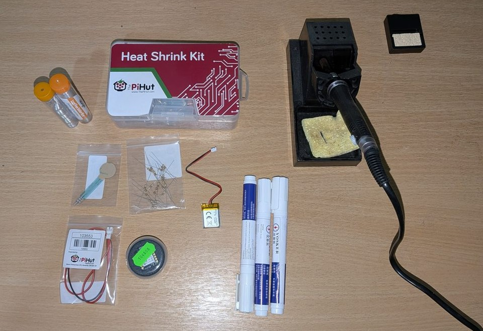

*From top left: 0.8mm solder, heat-shrink kit, soldering iron, FSR, 100 kΩ resistors, 150maH 3.7V LiPo battery with JST-PH connector, JST-PH battery extension cable (500mm), Seeed XIAO nRF52840 microcontroller, three flux pens.*

The first thing I did was test the FSR with my multimeter, to check it worked before soldering anything.

1. I turned the multimeter dial to the **2M** resistance setting (2 million ohms).
2. I touched one probe to each of the FSR's two metal legs.
3. Untouched, it showed `1`, which means "more than the range". So it's over 2 MΩ.
4. Pressed on the FSR, it showed `~0.003`, roughly 3 kΩ.

That's a big difference, which is exactly what I wanted. It also told me the 100 kΩ resistor was the right size.

## 5. Making the board blink

Before wiring anything, I wanted to prove I could program the board. The "hello world" of hardware is making an LED blink.

1. I installed the **Arduino IDE 2** on my Windows PC.
2. In **File > Preferences**, I added Seeed's board address to "Additional boards manager URLs".
3. In **Tools > Board > Boards Manager**, I searched for **Seeed nRF52 Boards** and installed it.
4. I chose **Tools > Board > Seeed nRF52 Boards > Seeed XIAO nRF52840**.
5. I plugged the board in with a USB-C cable. To find its port, I looked at **Tools > Port**, unplugged the board, looked again, and picked the one that came back when I plugged it in.
6. I opened **File > Examples > 01.Basics > Blink** and clicked the **Upload** arrow.

Out of the box, the board cycles red, green and blue. After my upload, only the red LED blinked on and off. This meant the upload was successful!

## 6. Testing Bluetooth

Next I wanted to check Bluetooth worked, still with no wiring. A small test sketch (`firmware/ble_test`) made the board send a message every second and answer `ping` with `pong`. I connected to it from the **Bluefruit Connect** app on my phone, and it worked.

Two things went wrong on the way:

- **The board disappeared from my PC.** A quick double-tap on the tiny reset button fixed it. That puts the board into "bootloader" mode, and it shows up as a USB drive.
- **Compiling failed with "No such file or directory".** My folder was called `Git Repositories`, with a space in it. The Seeed tools can't cope with spaces in paths. Moving the sketch to a folder with no spaces fixed it.

## 7. Designing and printing the case

I wanted everything in one small box that I could tape to the back of the vape. Claude helped me design a two-part case: a **tray** and a **lid** that pushes on. The design is a Python script (`case/generate_case.py`), so changing a size is just changing a number and running it again. The script makes the two STL files that the 3D printer software needs.

- It's 29.2 × 55.2 × 8.9 mm when closed.
- The battery lies flat at one end, with its socket beside it.
- The board sits at the other end, on a strip of 1 mm foam tape.
- There's a notch in the end wall for the USB-C port, so I can charge it without opening the case.
- There's a slot in the side for the two sensor wires.

Before printing, I also had Opus 5.5 design an interactive 3D model ([`docs/3d-model.html`](../docs/3d-model.html)) that showed where every part would go on the vape and how it would fit in the case. This helped me picture the whole thing before I'd built any of it.

### Printing it

I printed it on my **Ultimaker 2** in PLA, using **Cura** to slice it. These are the settings I ended up using:

| Setting | What I used |
|---|---|
| Layer height | **0.1 mm** |
| Infill | **20%** |
| Supports | **None** |
| Build plate adhesion | **None** (no brim, no raft) |

## 8. Preparing the battery cable

The battery has a small white plug (a JST plug). I didn't want to solder to the battery itself to prevent heat damage/an explosion from my careless soldering and to keep it detachable. Therefore, I bought the JST extension cable and cut the socket end to around 9cm so I could solder that to the microcontroller and just plug the battery in. 

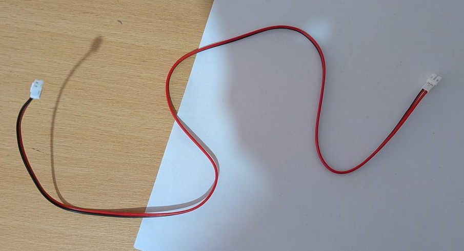

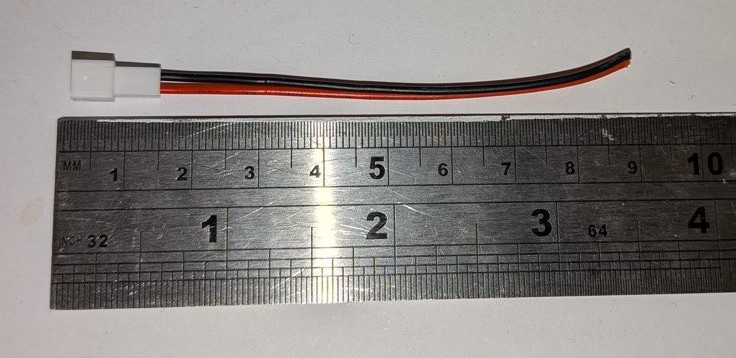

### Stripping the wires

To solder a wire, you need a few millimetres of bare metal at the end. I didn't have wire strippers, so I used a scalpel:

1. I rolled the wire under the blade, pressing lightly, to cut round the plastic about 3 to 5 mm from the end.
2. I pulled the cut bit of plastic off.
3. I twisted the thin copper strands together so they didn't fray.

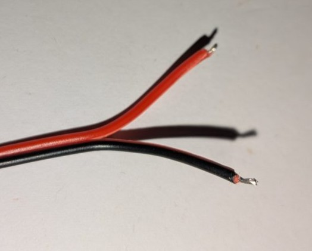

### Checking which wire is positive

JST cables aren't always wired the same way, so I had to check which wire was positive before soldering. Getting it backwards could damage the board.

1. I plugged the battery into the socket end.
2. I set the multimeter to **20 V DC** (the V with a straight line).
3. I touched the red probe to the red wire and the black probe to the black wire while ensuring they don't touch each other and short the battery.
4. The multimeter read **+3.94 V**, indicating that red was indeed positive.

## 9. My soldering iron broke :(

I tried to change the tip on my old iron, and the metal nut that holds the tip on wouldn't screw back on. The thread had stripped, so it just slid off.

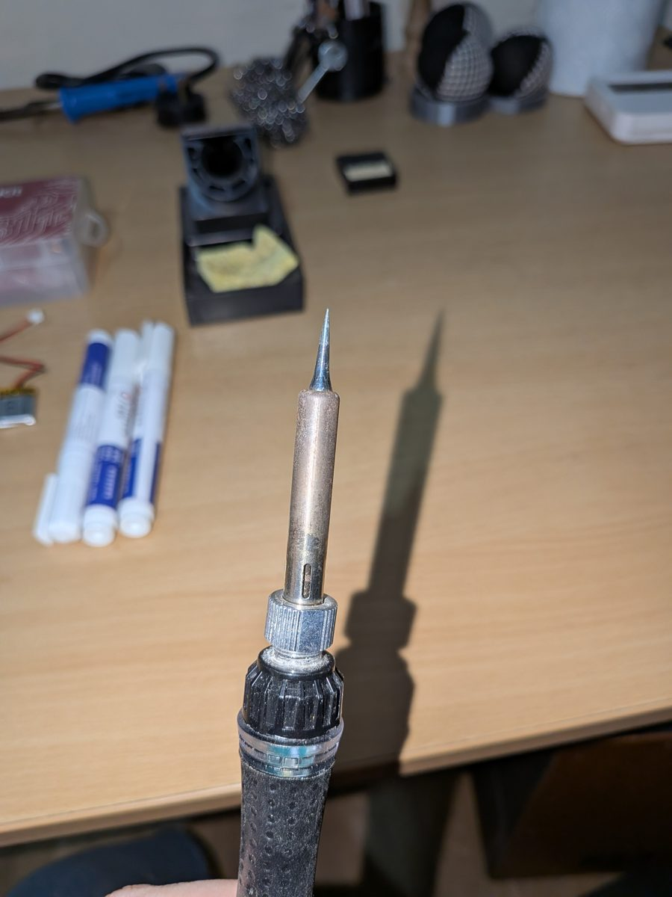

I tried for a while to save it, but it wasn't going to work. So I bought a [**Draper 40 W soldering station** from my local Toolstation](https://www.toolstation.com/draper-soldering-station/p62910?bvstate=pg:2%2Fct:r) for £36. 

## 10. Learning to solder

My soldering experience has always been frustrating. Back during my MSc degree, I had to create mini home-made mouse electroencephalograms (EEGs) and this was my least favourite part of the project as every connection I made just kept snapping. Apart from that, I did manage to successfully fix a potentiometer on my Ibanez Iceman guitar. 

Still, this experience was years old, so I practised on spare wire and a spare resistor first. From this, I learned several lessons.

### Looking after the tip

This turned out to be the most important thing. A dirty tip won't hold solder, no matter how hot it is.

1. Turn the iron on and set it to about **340 °C**. Not max!
2. When it's hot, wipe the tip on **brass wool** (not steel wool, which scratches the tip's coating).
3. Dip the tip in **tip tinner**. Mine is a solid paste in a little tin ([Thermaltronics TMT-TC-2 from Amazon](https://www.amazon.co.uk/dp/B00NS4J6BY?ref=ppx_yo2ov_dt_b_fed_asin_title)).
4. Melt a bit of fresh solder onto the tip, so it's shiny and silver.
5. Always leave a blob of solder on the tip when you put it back in the stand.

### Making a joint

1. Put a dab of **flux** on the pad or wire with the flux pen. Just press the tip down on it.
2. Touch the iron to the pad **and** the wire at the same time, so both get hot.
3. After a second or two, feed the solder into the joint, not onto the iron.
4. When it flows and looks shiny, take the solder away first, then the iron.
5. Don't move it for a few seconds while it cools.

### Using heat-shrink

Heat-shrink is a little plastic tube that shrinks when it gets hot. It covers a joint so it can't touch anything else.

1. Cut a piece about 1 to 2 cm long.
2. **Slide it onto the wire before you solder.** (I forgot this once. More on that later.)
3. After soldering, slide it over the joint.
4. Heat it with the side of the iron (not the tip) or a lighter held a little way off, until it shrinks tight.

## 11. Soldering the resistor

The first real joint was the 100 kΩ resistor. One leg goes in the **D1** hole and the other in the **GND** hole.

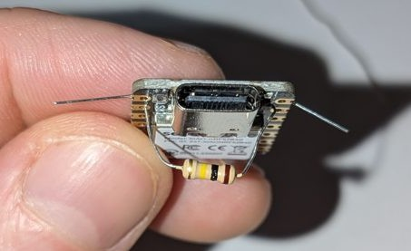

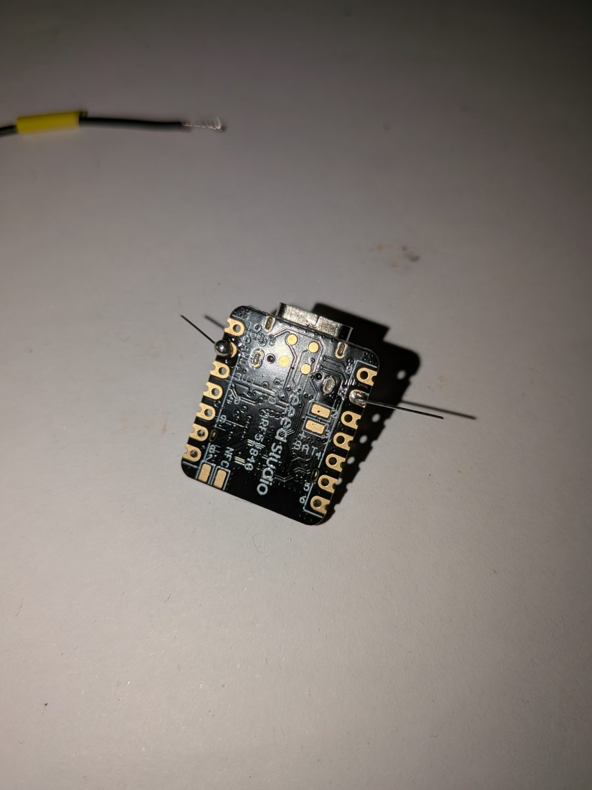

1. I bent the resistor's legs so they lined up with the D1 and GND holes, and pushed them through.
2. I soldered each leg on the underside.
3. I snipped off the extra length of leg.

### What went wrong

- **The solder just balled up.** It wouldn't stick to the tip, the leg or the board. I turned the heat up to max, and that made it worse. The tip had gone black (oxidised) from sitting hot without any solder on it. The fix was brass wool, then tip tinner, then fresh solder, as in the steps above. After that, it worked straight away.
- **The GND joint sat on the leg like a ball** instead of flowing onto the pad. I added fresh flux and held the iron on the pad and the leg together. Then it flowed properly.

I checked the resistor with the multimeter on the **200k** setting. It read about **55 kΩ**, not 100. That's normal: when a part is already on the board, other paths through the board change the reading.

## 12. Soldering the two sensor wires

The sensor needs two wires: one from **3V3** and one to **D1**. I used the spare cable from the JST lead.

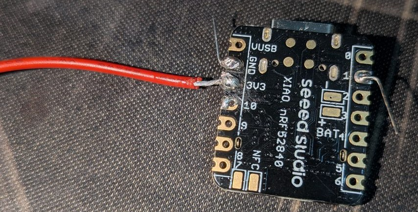

My 3V3 joint was messy and close to its neighbours. So before going any further, I checked for **shorts** (places where solder accidentally joins two pads):

1. Multimeter on **200k**.
2. Probes on 3V3 and GND: about **80 to 100 kΩ**.
3. Probes on 3V3 and the pad next to it (pin 10): about **55 kΩ**.

A short would read close to zero. These didn't, so nothing was joined that shouldn't be.

Then I added the D1 wire.

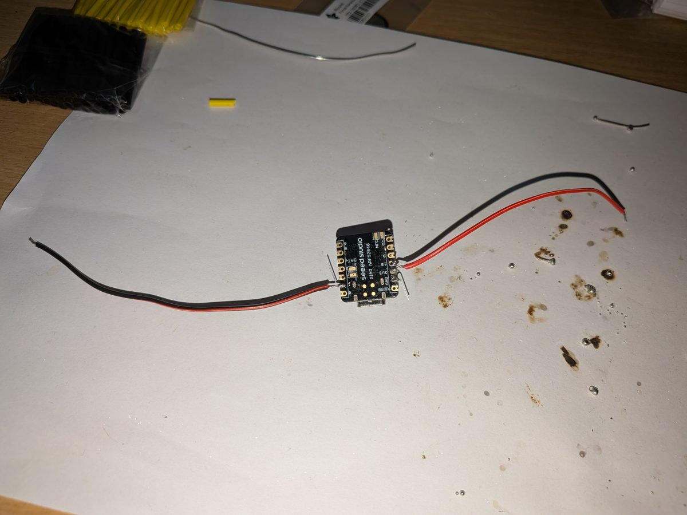

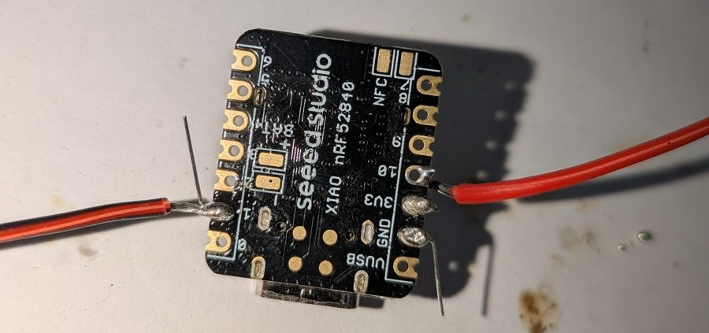

*The brown marks on the paper are burnt flux. It's normal, and it smells.*

## 13. Soldering the sensor

Next, the other ends of the two wires go onto the FSR's two legs. The FSR doesn't care which wire goes on which leg. It's just a resistor that changes when you press it.

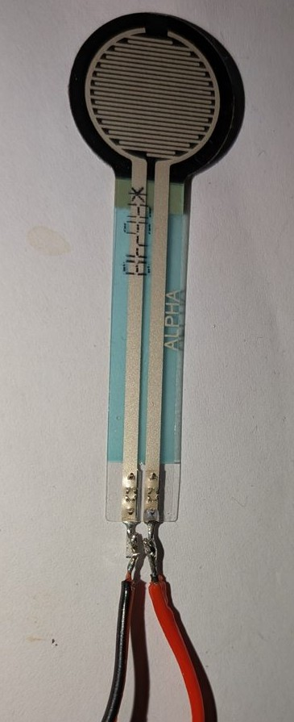

I forgot to slide the heat-shrink on first. Instead of starting again, I cut a slit down the side of a piece, wrapped it round the joint and shrank it. It looks a bit ugly, but it does the job. The important thing is that the two bare legs can't touch.

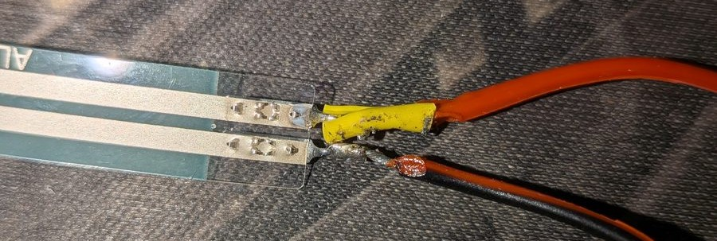

## 14. Soldering the battery lead

The last joint was the JST socket lead, onto the **BAT+** and **BAT−** pads on the underside of the board. These pads are small, so the flux pen really helped here.

- Red (positive, as checked earlier) goes to **BAT+**.
- Black goes to **BAT−**.

**Never solder with the battery plugged in.**

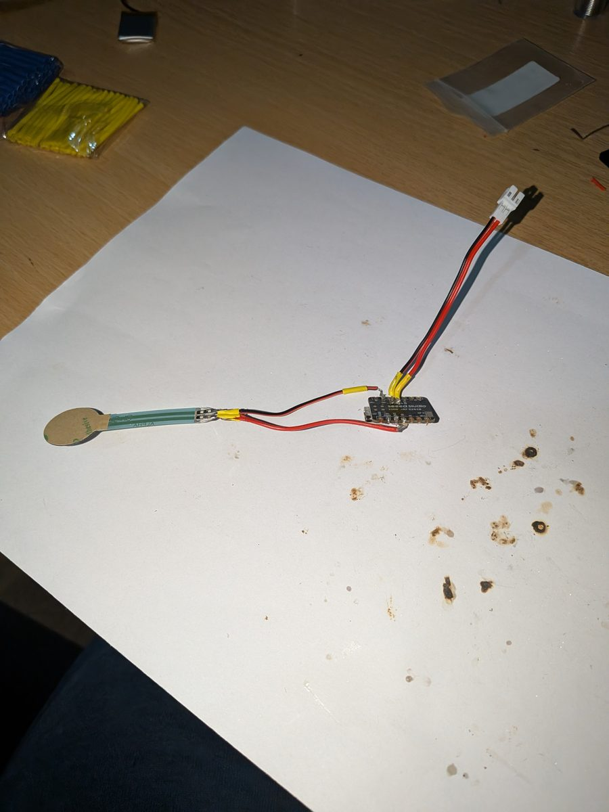

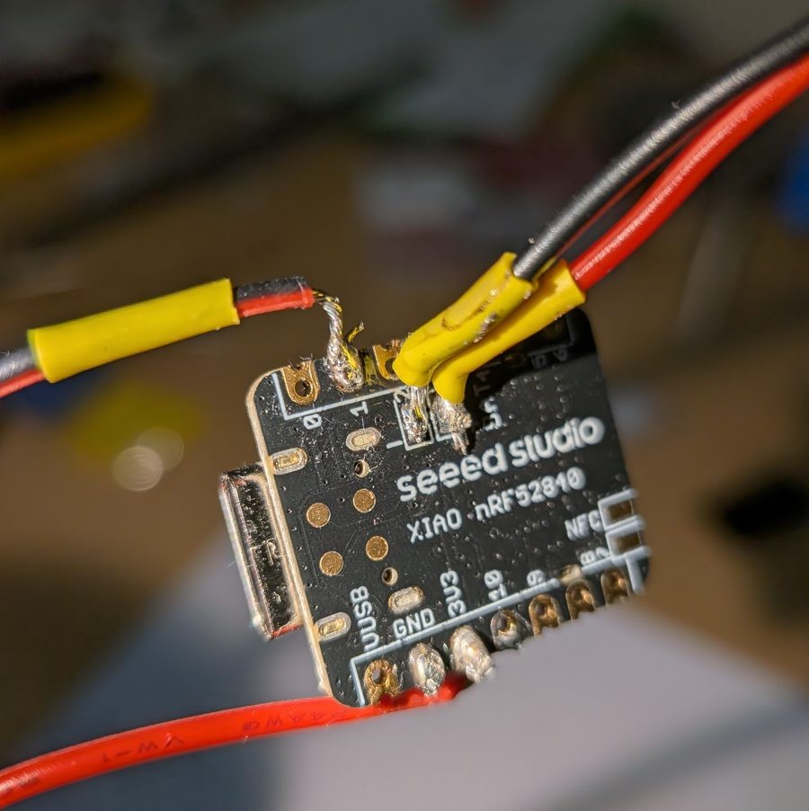

## 15. Testing the whole circuit

I used a small test sketch (`firmware/fsr_test`) that reads the sensor and prints the number. It also lights the red LED while the sensor is pressed.

1. Plug the board into the PC with USB-C. No battery yet.
2. Open `fsr_test.ino` in the Arduino IDE and click **Upload**.
3. Open **Tools > Serial Monitor** and set it to **115200 baud**.
4. Press the sensor and watch the numbers.

It printed **0 to 3** untouched and **close to 1000** when pressed. That's as good as it gets. (1023 is the top.)

### What went wrong

- **"undefined reference to `Serial`".** The sketch wouldn't build. On this board, the line `#include <Adafruit_TinyUSB.h>` has to be at the top of any sketch that uses `Serial`. Adding it fixed it.
- **The port disappeared again.** This time the double-tap didn't help. What worked was **Tools > Reload board data**.

### On battery

Finally, I unplugged the USB cable and plugged in the battery. I pressed the sensor, and the red LED lit up. It worked on battery alone! That was a great moment.

## 16. Giving it a name

"Vape Logger" was a bit dull. I thought of **Vaper Taper**, because the goal is to taper off. The tagline is **"Taper the vaper"**. The board now shows up over Bluetooth as `VaperTaper`.

## 17. The firmware

The firmware is the program that runs on the board all the time. I wrote it with **Claude Code**, describing what I wanted and testing each version on the real device.

Here's what it does, in plain terms:

- It checks the sensor **20 times a second** and sleeps in between, to save battery.
- A press shorter than a quarter of a second is ignored, so a knock in my pocket doesn't count.
- Every puff is saved with its **start time** and **how long it lasted**. The board keeps the last **2048** puffs in its memory, even if the battery runs out.
- The green LED flashes briefly each time a puff is saved, so I know it worked.
- It reports its **battery level** over Bluetooth.
- My PC and my phone can **both** be connected at the same time.
- The board has no real clock, so the app tells it the time every time it connects.

To put it on the board, I opened `firmware/vaper_taper/vaper_taper.ino` in the Arduino IDE and clicked **Upload**, just like Blink.

## 18. The app

The app is also written with Claude Code. It's a web page that talks to the board over **Web Bluetooth**. It works in Chrome or Edge on my PC, and in Chrome on my Android phone. It can be installed so it opens like a normal app. All the data stays on my own devices.

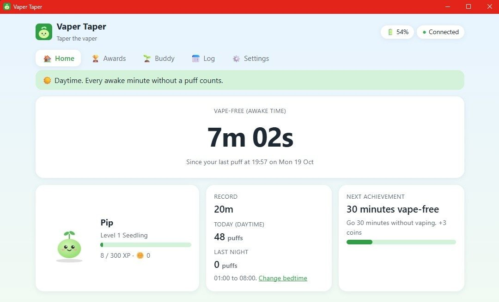

The home screen shows:

- **Vape-free time:** how long since my last puff. It only counts awake time, so sleeping doesn't count as "not vaping".
- **Record:** my longest gap so far.
- **Today's puffs**, and **last night's** puffs separately. Night is 01:00 to 08:00 by default, and I can change bedtime for any night.
- **Battery level**, with a warning when it gets low.
- **Pip**, my little buddy. Pip levels up as I earn XP from going longer without vaping.
- My **next achievement** to aim for.

There's also a log with a chart of puffs per hour for each day, and the average gap between vaping sessions.

On Windows, there's a tray app version (`desktop/`). It's the same app, but it connects by itself, sits in the system tray and starts with Windows. That fixed an annoying problem: the browser kept asking me to pick the device again after every refresh.

### What went wrong

- **The browser kept forgetting the device.** Reconnecting automatically needs the **Experimental Web Platform features** flag (in `edge://flags` or `chrome://flags`). The tray app avoids this altogether.
- **Stuck on "Connecting…".** After about 49 minutes, the tray app lost the device and never got it back. Windows sometimes gives an incomplete answer when reconnecting. The fix was to give up on each attempt after 30 seconds, and start afresh after three failures.

## 19. Putting it on the vape

For now, it's held on with clear tape. The FSR sits flat over the fire button, and its tail runs round the side to the case on the back.

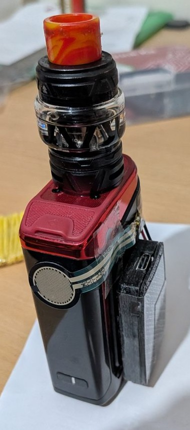


I press the fire button exactly as before. The green LED flashes, and the puff shows up in the app a second or two later.

## 20. What I learned

- **Keep the tip clean and tinned.** Almost all my soldering trouble was a dirty tip. More heat doesn't fix it.
- **Flux makes everything easier.** Use it on every joint.
- **Heat the pad and the wire together.** Feed the solder into the joint, not onto the iron.
- **Slide heat-shrink on before you solder.**
- **Check for shorts with a multimeter before plugging in.**
- **Check battery polarity before soldering the battery lead.**
- **No spaces in folder names** for Arduino sketches on this board.
- **If the board's port vanishes,** try **Tools > Reload board data**, then a double-tap on reset.
- **Practise first.** A few joints on spare wire saved my real board.
- **Remove the location data from phone photos** before putting them online. Phone photos have GPS coordinates hidden in them.

## 21. What's next

- Wear it for a week and see what the data says about my habits.
- Measure how much power it uses while sleeping, to work out the battery life.
- Make a proper clip-on sleeve that fits the Aegis Legend 5, instead of tape.
- Keep tapering!

---

*All the code, the case files and a more detailed build journal are on GitHub: [kaptainkris92/vape-logger](https://github.com/kaptainkris92/vape-logger).*
